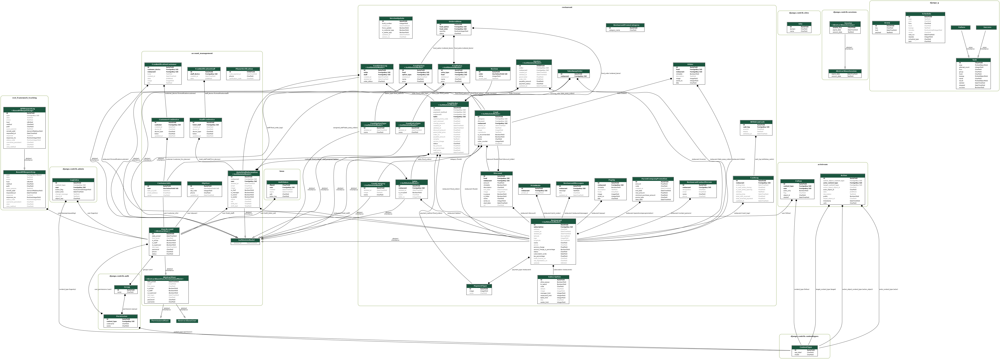

# TableFlow — Restaurant Management Backend

**Suggested project name: TableFlow.** It reflects the flow from tables and food orders to kitchen updates and invoices. This is a naming suggestion; the Python packages have not been renamed.

A Django REST backend for restaurant operations, with customer and staff accounts, menu management, table assignments, food orders, invoices, promotions, reviews, and real-time updates. This repository contains backend code, Django admin, API documentation routes, and invoice/report templates. A separate customer or staff frontend is not included.

## Database image



The image above is the database diagram already included in the repository. [Open the full-size image](database.png) to inspect the tables. It is a design reference, not a screenshot of a running application; its consistency with the latest migrations has not been verified.

## Technology

| Component | Implementation |
| --- | --- |
| API | Django 3.1.4, Django REST Framework 3.12.1 |
| Authentication | Django REST Knox |
| API documentation | drf-yasg2, Swagger, ReDoc |
| Real-time updates | Django Channels with Redis |
| Background tasks | Django Q with Redis |
| Database | Configurable through `DATABASE_URL`; models include PostgreSQL `ArrayField` |
| File storage | S3-compatible storage through django-storages |
| Integrations | SMS, FCM notifications, PrintNode, PDF/invoice generation |

## Execution report

Checked on **November 26, 2026**, using **Python 3.9.25**.

**Result: startup was attempted, but the application could not run in this environment.** No successful HTTP response, database migration, or application screenshot was produced.

| Check | Result |
| --- | --- |
| `python manage.py check` | Failed: Django is not installed (`ModuleNotFoundError: No module named 'django'`). |
| `python manage.py runserver 127.0.0.1:8000 --noreload` | Failed at the same Django import, before the server started. |
| Install `requirements.txt` in an isolated virtual environment | Failed on `aioredis==1.3.1`: pip reported no matching distribution from the package source available to this environment. Remaining dependencies were not installed. |
| `python -m compileall -q manage.py ihost account_management restaurant utils` | Passed: the Python source compiled without syntax errors. This does not validate imports or runtime behavior. |

The startup failure was:

```text
ModuleNotFoundError: No module named 'django'
ImportError: Couldn't import Django. Are you sure it's installed and
available on your PYTHONPATH environment variable? Did you forget to
activate a virtual environment?
```

### Additional blockers found during source review

1. **Project package mismatch.** The settings package is `ihost/`, but `manage.py`, WSGI/ASGI entry points, settings paths, and several application imports reference `restaurant_management_system`. These references must be aligned before startup can succeed. Passing `--settings=ihost.settings` alone does not fix the remaining imports.
2. **Missing local configuration.** No `.env` was present. Settings require the variables listed below.
3. **Database requirements.** Settings default to SQLite without `DATABASE_URL`, but the models use PostgreSQL `ArrayField`. Use PostgreSQL when preparing a full database run.
4. **External services.** Redis is configured at `127.0.0.1:6379` for Channels and Django Q. Uploads/static storage, SMS, push notifications, and printing require their own service configuration for those features to work.

These are source-review findings; dependency installation stopped before Django could validate them. Runtime source files were left unchanged.

## Local setup checklist

The following is a setup guide, **not a verified successful startup procedure**. Resolve the package mismatch above first. The dependency pins are from 2020–2021; installation on a modern environment may require compatibility work.

1. Create a virtual environment and install the pinned dependencies from an accessible package index:

   ```bash
   python -m venv env
   source env/bin/activate
   python -m pip install -r requirements.txt
   ```

2. Create a local `.env` containing the required settings:

   | Variable | Purpose |
   | --- | --- |
   | `SECRET_KEY` | Local Django secret |
   | `DEBUG` | Debug setting; use `True` for local setup |
   | `ALLOWED_HOSTS` | Comma-separated hosts, such as `127.0.0.1,localhost` |
   | `DATABASE_URL` | PostgreSQL connection URL |
   | `PRODUCTION_ACTIVATED` | Storage bucket selection; use `False` for local setup |
   | `AWS_ACCESS_KEY_ID` | S3-compatible access key |
   | `AWS_SECRET_ACCESS_KEY` | S3-compatible secret key |
   | `SSL_SMS_API_TOKEN` | SMS integration token |
   | `FCM_SERVER_KEY` | Push notification integration key |

   Optional storage settings include `AWS_STORAGE_BUCKET_NAME`, `AWS_STORAGE_BUCKET_NAME_DEV`, `AWS_S3_CUSTOM_DOMAIN`, and `AWS_S3_ENDPOINT_URL`. Keep credentials in the ignored `.env` file. Storage remains configured for S3 even when `PRODUCTION_ACTIVATED=False`.

3. Start PostgreSQL and Redis, then validate and initialize the application:

   ```bash
   python manage.py check
   python manage.py migrate
   python manage.py createsuperuser
   python manage.py runserver 127.0.0.1:8000
   ```

4. If background jobs are needed, run the worker in another activated terminal:

   ```bash
   python manage.py qcluster
   ```

## Routes to try after startup

These paths are declared in the source and were **not verified over HTTP** in this run.

| Path | Purpose |
| --- | --- |
| `/admin/` | Django administration |
| `/swagger/` | Swagger API documentation |
| `/redoc/` | ReDoc API documentation |
| `/api/account_management/` | Account endpoints |
| `/api/restaurant_management/dashboard/` | Restaurant dashboard endpoints |
| `/api/restaurant_management/apps/customer/` | Customer endpoints |
| `/api/restaurant_management/apps/waiter/` | Waiter endpoints |

WebSocket routes include `/ws/dashboard/<restaurant_id>/`, `/ws/apps/customer/<order_id>/`, and `/ws/apps/waiter/<waiter_id>/`.

## Code layout

```text
manage.py               Django command-line entry point
ihost/                  Settings, URL configuration, WSGI and ASGI
account_management/     Users, staff, customers, authentication and notifications
restaurant/             Menus, tables, orders, invoices, promotions and WebSockets
utils/                  Storage, pricing, SMS, FCM and printing helpers
requirements.txt        Pinned Python dependencies
database.png            Existing database diagram
```
